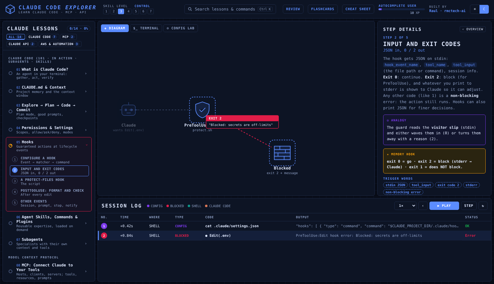

# 🤖 Claude Code Explorer — Learn Claude Code, MCP, the Claude API and Claude on AWS

An interactive, step-by-step course that follows the **Claude Academy** path for builders (Claude Code 101, Claude Code in Action, subagents, agent skills, MCP, Building with the Claude API and Claude on Amazon Bedrock), focused on **cloud, AI automation and security** work: the agent loop, CLAUDE.md memory, the explore-plan-code-commit workflow, permissions and settings, hooks, skills, subagents, MCP servers, the Messages API with tool use, Claude on Amazon Bedrock, headless mode and GitHub Actions, and using Claude Code safely. Every lesson animates how Claude works, with analogies, memory hooks, trigger words, quizzes, and a **Config Lab** where you write real Claude Code files and a simulator shows what Claude would be allowed to do.

> Created by **Raul** ([@rmctech-ai](https://github.com/rmctech-ai)) · Freelance AI Automation Specialist on the path to Cloud Security.
> Part of the Explorer series: [Linux Explorer](https://github.com/rmctech-ai/linux-explorer) · [Python Explorer](https://github.com/rmctech-ai/python-explorer) · [IAM Explorer](https://github.com/rmctech-ai/iam-explorer) · [VPC Explorer](https://github.com/rmctech-ai/vpc-explorer) · [IaC Explorer](https://github.com/rmctech-ai/iac-explorer) · [Serverless Explorer](https://github.com/rmctech-ai/serverless-explorer) · [CI/CD Explorer](https://github.com/rmctech-ai/cicd-explorer) · [Cloud Security Explorer](https://github.com/rmctech-ai/cloudsecurity-explorer) · [Well-Architected Explorer](https://github.com/rmctech-ai/wellarchitected-explorer) · [Security Journey Explorer](https://github.com/rmctech-ai/aws-security-journey) · [n8n Explorer](https://github.com/rmctech-ai/n8n-explorer) · [SAA Explorer](https://github.com/rmctech-ai/saa-explorer).
> 🏠 Part of **[Raul's Cloud Learning Hub](https://rmctech-ai.github.io/)** · Live course: https://rmctech-ai.github.io/ClaudeCode-Explorer/
> The Explorer course format is inspired by [Protocol Explorer](https://protocol-explorer-alpha.vercel.app/) by Dilum Sanjaya. All lessons, labs and study tools are my own work.



---

## ▶ Run it

No build step. Plain HTML/CSS/JS.

```bash
python3 -m http.server 8000     # then open http://localhost:8000
```

### Publish on GitHub Pages
```bash
git init && git add . && git commit -m "Claude Code Explorer"
git branch -M main
git remote add origin https://github.com/rmctech-ai/ClaudeCode-Explorer.git
git push -u origin main
```
GitHub → **Settings → Pages → Deploy from a branch → `main` / root → Save** → `https://rmctech-ai.github.io/ClaudeCode-Explorer/`

---

## 🧭 How to use it

| Area | What it does |
|---|---|
| **Lessons** (left) | 14 lessons grouped by track. Click to expand steps. Dots show progress. |
| **Diagram** tab | Animated scene for every step. |
| **$_ TERMINAL** tab | Types out real commands/code for the step with realistic output. |
| **⚙ CONFIG LAB** tab | **Config Lab**: write a project's Claude Code files in one YAML document (`files:` → `CLAUDE.md`, `.claude/settings.json`, hook scripts, `.claude/skills/*/SKILL.md`, `.claude/agents/*.md`, `.mcp.json`, Messages API requests in `api/*.json`, IAM policies, GitHub workflows) and press CHECK. A doctor validates each file the way Claude Code would load it (frontmatter, rule syntax, hook structure, secrets in committed files, API request shape, tool_use/tool_result pairing), and a simulator decides each attempted tool call: PreToolUse hooks first, then deny → ask → allow rules, then the permission mode. |
| **Step Details** (right) | Explanation, **Analogy**, **Memory Hook**, **Trigger Words**, real-world notes, warnings. |
| **Session Log** (bottom) | Log of every command so far with type, output and status. |
| **XP & levels** | Earn XP for steps, lessons, quizzes and challenges. Saved in your browser. |
| **Cheat Sheet** | Master hooks + key syntax for every lesson (also [`CHEATSHEET.md`](CHEATSHEET.md)). |

**Keyboard:** `→` / `←` steps · `Space` play · `Ctrl+K` search · `Esc` close.

---

## 📚 Curriculum (14 lessons · 70 steps · 56 quiz questions · 14 hands-on challenges)

| # | Lesson | Track | You'll learn |
|---|---|---|---|
| 01 | What is Claude Code? ⚑ | CLAUDE CODE | An agent in your terminal: gather, act, verify |
| 02 | CLAUDE.md & Context ⚑ | CLAUDE CODE | Project memory and the context window |
| 03 | Explore → Plan → Code → Commit ⚑ | CLAUDE CODE | Plan mode, good prompts, checkpoints |
| 04 | Permissions & Settings ⚑ | CLAUDE CODE | Scopes, allow/ask/deny, modes |
| 05 | Hooks ⚑ | CLAUDE CODE | Guaranteed actions at lifecycle events |
| 06 | Agent Skills, Commands & Plugins ⚑ | CLAUDE CODE | Reusable expertise, loaded on demand |
| 07 | Subagents ⚑ | CLAUDE CODE | Specialists with their own context and tools |
| 08 | MCP: Connect Claude to Your Tools ⚑ | MCP | Hosts, clients, servers; tools, resources, prompts |
| 09 | Build an MCP Server ⚑ | MCP | FastMCP, tool schemas, Inspector, advanced topics |
| 10 | The Claude Messages API ⚑ | CLAUDE API | Requests, system prompts, tokens, streaming |
| 11 | Tool Use & Agent Patterns ⚑ | CLAUDE API | tools, tool_use, tool_result, structured output |
| 12 | Claude on Amazon Bedrock ⚑ | AWS & AUTOMATION | IAM, regions, private access, Claude Code on Bedrock |
| 13 | Headless, GitHub Actions & the Agent SDK ⚑ | AWS & AUTOMATION | Claude in pipelines and products |
| 14 | Capstone: A Secure Claude Code Setup ⚑ | AWS & AUTOMATION | Claude as your cloud security teammate |

⚑ = has a hands-on challenge.

## 🎯 Study plan & capstone

- **Week 1:** Lessons 1–7 (Claude Code: agent loop, CLAUDE.md, workflow, permissions, hooks, skills, subagents) alongside Claude Code 101, Claude Code in Action, and the subagents and agent skills courses.
- **Week 2:** Lessons 8–11 (MCP and the Claude API) alongside Introduction to MCP, MCP Advanced Topics and Building with the Claude API.
- **Week 3:** Lessons 12–14 (Claude on Amazon Bedrock, automation, security capstone) alongside the Claude on Bedrock course.

**Capstone:** Create a `cloud-security-review` repository with the lesson 14 setup (CLAUDE.md, deny rules for secrets, a protect-files hook, an `aws-cost` skill, a read-only `security-reviewer` subagent, a GitHub MCP server via environment variables) and a GitHub Actions workflow that reviews pull requests with Claude. Document it with screenshots of Claude reviewing a Terraform change.

## License
MIT © 2026 Raul (rmctech-ai)
